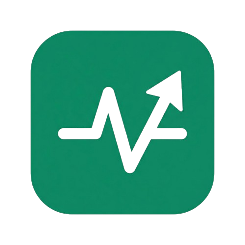

<div align="center">



# WayCare

**Plataforma de Engajamento Preventivo em Saúde**

[](https://react.dev/)
[](https://vitejs.dev/)
[](https://tailwindcss.com/)
[](/)

*Challenge Care Plus — FIAP 2025/2026 · 1º ano de Engenharia de Software*

</div>

---

## Índice

- [Sobre o Projeto](#sobre-o-projeto)
- [Funcionalidades](#funcionalidades)
- [Tecnologias](#tecnologias)
- [Arquitetura da Dock](#arquitetura-da-dock)
- [Estrutura de Pastas](#estrutura-de-pastas)
- [Pré-requisitos](#pré-requisitos)
- [Instalação e Execução](#instalação-e-execução)
- [Variáveis de Ambiente](#variáveis-de-ambiente)
- [Simulador da Dock](#simulador-da-dock)
- [Páginas da Aplicação](#páginas-da-aplicação)
- [Funções do Supabase](#funções-do-supabase)
- [Limitações conhecidas](#limitações-conhecidas)
- [Design System](#design-system)
- [Integrantes](#integrantes)

---

## Sobre o Projeto

O **WayCare** é uma aplicação web de saúde gamificada desenvolvida em parceria com a **Care Plus**. O objetivo é transformar hábitos preventivos em uma experiência motivadora por meio de trilhas personalizadas, missões diárias, conquistas e um sistema de recompensas baseado em **Health Coins (HC)**.

O projeto integra-se com a **WayCare Dock** — um dispositivo IoT baseado em ESP32 que pesa a garrafa, detecta cada gole e envia os dados para o **Supabase**. O site entra com login por código no e-mail e lê o consumo do dia, a meta e o estado da dock direto do banco. Sem conta, dá para explorar tudo no **modo demonstração**, com valores simulados.

### Sprints de Desenvolvimento

| Sprint | Foco | Status |
|--------|------|--------|
| Sprint 1 | Prototipagem, levantamento de requisitos e HTML/CSS/Bootstrap | ✅ Entregue |
| Sprint 2 | Migração para React + Vite, Context API e componentização | ✅ Entregue |
| Sprint 3 | Integração IoT, JSON local, Tailwind CSS, novas páginas e deploy | ✅ Entregue |

---

## Funcionalidades

### Aplicação

| Funcionalidade | Descrição |
|---|---|
| 🔐 Autenticação | Entrar ou criar conta com código de 6 dígitos no e-mail (sem senha), ou explorar no modo demonstração |
| 😊 Seleção de Humor | Escolha do humor do dia com badge dinâmica e trilhas recomendadas |
| 🏠 Dashboard | Visão geral de missões, trilha ativa, descobertas e banner de recompensas |
| 🛤️ Trilhas | Cards expansíveis com painel de missões, filtros por categoria e busca |
| 🎯 Detalhes da Missão | Página dedicada com descrição completa e dicas práticas |
| 🏆 Conquistas | Progresso visual de badges desbloqueados e bloqueados |
| 💡 Descobertas | Insights personalizados gerados pelos hábitos do usuário |
| 🎁 Recompensas | Catálogo com filtros e fluxo completo de resgate com confirmação |
| 👤 Perfil | Estatísticas, conquistas recentes e meta de hidratação personalizada |
| 💧 WayCare Bottle | Dados reais da dock: consumo, LED, bateria, Wi-Fi, eventos do dia, gráficos e tara pelo site |
| 🔌 Conectar a dock | Primeiro uso em três passos: completar o perfil, vincular a dock pelo código e zerar a balança |
| 💰 Carteira | Saldo de Health Coins, histórico e gráfico semanal |
| 🔔 Notificações | Central de notificações com contador de não lidas |

### Técnicas

- **Supabase** — login por código (OTP) e leitura do `painel()` a cada 10 s, pausando com a aba em segundo plano (`DockContext`)
- **Dois modos num hook só** — `useHidratacao()` entrega consumo, meta, dock e eventos tanto da conta real quanto do modo demonstração, com `modo` = `demo`, `sem-perfil`, `sem-dock`, `dock-online` ou `dock-offline`
- **Dock offline não perde dados** — as leituras ficam guardadas na dock e sobem quando ela volta a ter Wi-Fi
- **Meta de hidratação personalizada** — calculada no navegador por peso, gênero, atividade e temperatura da cidade (Open-Meteo), recalculada uma vez por dia
- **Health Coins pela água real** — 1 HC a cada 25 ml registrados pela dock, e a missão de água conclui sozinha ao bater a meta
- **Dados em JSON local** — trilhas, missões, recompensas e conquistas em `src/data`, carregados pelo hook `useDados` (cada JSON vira um arquivo próprio no build)
- **Persistência com localStorage** — humor no navegador; Health Coins, XP, missões e resgates também, mas separados por conta (veja [Limitações conhecidas](#limitações-conhecidas))
- **Tailwind CSS v4** integrado ao design system próprio
- **Responsividade completa** — Desktop, Tablet e Mobile, com barra fixa e menu lateral no celular
- **Páginas sob demanda** — `React.lazy` + `Suspense`: o código de cada página só é baixado quando a rota abre
- **Componentes base** — `Button`, `Card`, `Chip`, `FiltroPills`, `Topbar` e `Icone` (ícones do lucide-react)
- **Acessibilidade** — contraste mínimo de 4,5:1, foco visível, navegação por teclado e respeito ao movimento reduzido

---

## Tecnologias

| Tecnologia | Versão | Finalidade |
|---|---|---|
| [React](https://react.dev/) | 19 | Biblioteca principal de UI |
| [Vite](https://vitejs.dev/) | 8 | Build tool e dev server |
| [React Router](https://reactrouter.com/) | 7 | Roteamento SPA |
| [Tailwind CSS](https://tailwindcss.com/) | 4 | Classes utilitárias (`@tailwindcss/vite`) |
| [Motion](https://motion.dev/) | 12 | Animações (`motion/react`) |
| [Lucide React](https://lucide.dev/) | 1.17 | Ícones |
| [Supabase](https://supabase.com/) (`@supabase/supabase-js`) | 2 | Login por código e dados da dock (Postgres + RPC) |
| [Open-Meteo](https://open-meteo.com/) | — | Busca da cidade e temperatura atual para a meta |
| Context API | — | Gerenciamento de estado global |
| localStorage | — | Persistência no navegador |

---

## Arquitetura da Dock

```
┌─────────────────┐  dock_sync (leituras,   ┌────────────────────────┐   painel(), historico(),   ┌──────────────────┐
│   ESP32         │  bateria, Wi-Fi)        │        Supabase         │   pedir_tara(), ...        │   Site WayCare   │
│  (WayCare Dock) │ ──────────────────────► │  Postgres + RLS + Auth  │ ◄───────────────────────── │  (este projeto)  │
│                 │ ◄────────────────────── │  goles, metas, eventos  │ ─────────────────────────► │                  │
└─────────────────┘  LED, tara pendente     └────────────────────────┘   login por código (OTP)   └────────┬─────────┘
                                                                                                         │
                                                              DockContext (painel a cada 10 s) ──► useHidratacao()
                                                                                                         │
                                                                     Sidebar · Topbar · Dashboard · Bottle · Perfil
```

- A **dock** envia as leituras para a função `dock_sync` do Supabase e recebe de volta a cor do LED e os pedidos pendentes (como a tara). Ela envia na hora quando há leitura nova e, sem leitura, conecta a cada 5 minutos.
- O **banco** transforma as leituras em goles, reabastecimentos e no consumo do dia. A dock e o banco são mantidos por outro integrante do grupo.
- O **site** entra com login por código, chama `painel()` a cada 10 s e mostra os dados em todas as telas pelo hook `useHidratacao()`. Sem conta, tudo funciona no modo demonstração.

---

## Estrutura de Pastas

```
waycare-react/
├── public/
│   ├── images/                        # Logo (original, 64 px e 192 px)
│   ├── favicon-32x32.png
│   ├── apple-touch-icon.png
│   └── robots.txt
├── src/
│   ├── components/
│   │   ├── AppLayout.jsx               # Sidebar, barra do celular e <Outlet /> das páginas
│   │   ├── RotaPrivada.jsx             # Exige conta (Supabase) ou modo demonstração
│   │   ├── Topbar.jsx                  # Cabeçalho das páginas (título, estado da dock, HC, carteira, sino)
│   │   ├── EstadoDock.jsx              # Indicador do estado da dock no Topbar
│   │   ├── AvisoPrimeiroUso.jsx        # Aviso do passo pendente (perfil, vínculo ou tara)
│   │   ├── Sidebar.jsx                 # Navegação com o consumo do dia e o status da dock
│   │   ├── Button.jsx · Card.jsx · Chip.jsx · FiltroPills.jsx   # Componentes base
│   │   ├── Icone.jsx                   # Ícones do lucide-react a partir de nomes "fa-*"
│   │   ├── CarregandoPagina.jsx        # Skeleton enquanto uma página carrega
│   │   ├── DocumentoLegal.jsx          # Layout de Termos e Privacidade
│   │   ├── GarrafaAnimada.jsx          # SVG animado com nível de água dinâmico
│   │   ├── GraficoHidratacao.jsx       # Gráfico de área do consumo acumulado do dia
│   │   └── PerfilMetaHidratacao.jsx    # Formulário da meta de hidratação (salva no Supabase)
│   ├── context/
│   │   ├── AppContext.jsx              # Estado global (sessão, usuário, HC, XP, humor, garrafa do demo)
│   │   └── DockContext.jsx             # painel() do Supabase a cada 10 s e meta do dia
│   ├── data/                           # JSONs das telas (carregados com useDados)
│   │   └── *.json
│   ├── hooks/
│   │   ├── useDados.js                 # Carrega um JSON de src/data sob demanda
│   │   ├── useHidratacao.js            # Dados de hidratação da conta real ou do modo demonstração
│   │   ├── useHistoricoHidratacao.js   # Goles do dia e últimos 7 dias para os gráficos
│   │   ├── useTara.js                  # Pedido de tara pelo site
│   │   └── useCreditoAgua.js           # Health Coins pela água real e missão de água
│   ├── lib/
│   │   ├── supabase.js                 # Cliente do Supabase e rpc() com mensagens em português
│   │   ├── meta.js                     # Cálculo da meta (cópia do PWA da dock) e Open-Meteo
│   │   └── tempo.js                    # "há 5 min" e horas no fuso de São Paulo
│   ├── pages/
│   │   ├── Login.jsx                   # Entrar ou criar conta por código; modo demonstração
│   │   ├── Onboarding.jsx
│   │   ├── Dashboard.jsx
│   │   ├── SelecionarHumor.jsx
│   │   ├── Trilhas.jsx
│   │   ├── DetalhesMissao.jsx
│   │   ├── MissaoCompleta.jsx
│   │   ├── Conquistas.jsx
│   │   ├── Descobertas.jsx
│   │   ├── Recompensas.jsx
│   │   ├── ConfirmarResgate.jsx
│   │   ├── SucessoResgate.jsx
│   │   ├── Perfil.jsx
│   │   ├── Configuracoes.jsx
│   │   ├── WayCareBottle.jsx
│   │   ├── VincularDock.jsx            # Primeiro uso: perfil, vínculo e tara
│   │   ├── Carteira.jsx
│   │   ├── Notificacoes.jsx
│   │   ├── Termos.jsx
│   │   ├── Privacidade.jsx
│   │   └── Notfound.jsx
│   ├── styles/
│   │   ├── global.css                  # Design System + @import "tailwindcss"
│   │   └── *.css                       # Estilos por página
│   ├── App.jsx                         # Rotas (páginas com React.lazy) e CSS das páginas
│   └── main.jsx                        # Ponto de entrada
├── scripts/
│   └── simular-dock.mjs                # Dock falsa para testar sem o hardware (npm run dock)
├── docs/
│   └── proposta-hc-supabase.md         # Proposta para levar as Health Coins ao Supabase
├── .env.local                          # Chaves do Supabase (não versionado)
├── .env.example                        # Modelo das variáveis necessárias
├── index.html
├── package.json
├── vite.config.js
└── README.md
```

---

## Pré-requisitos

Antes de começar, certifique-se de ter instalado:

- **[Node.js](https://nodejs.org/)** versão **20.19 ou superior** (ou 22.12+)
- **[npm](https://www.npmjs.com/)** versão **10 ou superior** *(já incluído com o Node.js)*

Para verificar se já estão instalados:

```bash
node --version   # deve exibir v20.19.x ou superior
npm --version    # deve exibir 10.x.x ou superior
```

---

## Instalação e Execução

### 1. Clone o repositório

```bash
git clone https://github.com/1ESPA-Yan/waycare-webdev.git
cd waycare-webdev
```

Ou, se preferir via ZIP, extraia o arquivo e acesse a pasta:

```bash
cd waycare-react
```

> ⚠️ A pasta `node_modules` **não está incluída** no repositório. Execute o passo 2 para instalá-la.

### 2. Instale as dependências

```bash
npm install
```

### 3. Configure o Supabase (opcional)

Copie o `.env.example` para `.env.local` e preencha com a URL e a chave anon do projeto Supabase (veja [Variáveis de Ambiente](#variáveis-de-ambiente)). Sem esse arquivo, o login por código fica indisponível e o site funciona só no **modo demonstração**.

### 4. Execute em modo de desenvolvimento

```bash
npm run dev
```

O terminal exibirá algo como:

```
  VITE v8.x.x  ready in Xms

  ➜  Local:   http://localhost:5173/
  ➜  Network: use --host to expose
```

Acesse **[http://localhost:5173](http://localhost:5173)** no navegador.
A aplicação abrirá na página de **Login**: informe o e-mail para receber o código, ou clique em **Explorar em modo demonstração**.

### 5. Gere a versão de produção

```bash
npm run build
```

Os arquivos otimizados serão gerados na pasta `dist/`. Para visualizar localmente antes do deploy:

```bash
npm run preview
```

## Variáveis de Ambiente

Ficam no `.env.local` (não versionado) e, no deploy, em **Vercel > Project Settings > Environment Variables**.

| Variável | Obrigatória | Descrição |
|---|---|---|
| `VITE_SUPABASE_URL` | Não | Project URL do Supabase (ex: `https://seu-projeto.supabase.co`) |
| `VITE_SUPABASE_KEY` | Não | Chave anon (pública) do projeto. Nunca use a chave `service_role` no site |

> **Sem as variáveis**, o app opera só no **modo demonstração**: os dados da garrafa são simulados no navegador e todas as demais funcionalidades continuam funcionando.

No painel do Supabase, em **Authentication > URL Configuration**, cadastre os endereços do site (ex.: `http://localhost:5173` e o domínio da Vercel) em **Redirect URLs**, para o link do e-mail de login voltar para o site. Para o código de 6 dígitos chegar no e-mail, o template de e-mail precisa conter `{{ .Token }}`.

---

## Simulador da Dock

Para testar sem o hardware, o script `scripts/simular-dock.mjs` faz o papel da dock: chama a `dock_sync` do Supabase com a chave anon, no mesmo formato do firmware. O estado da dock simulada fica num arquivo na pasta temporária do sistema.

```bash
npm run dock                   # ajuda com todos os comandos
npm run dock -- registrar      # cria a dock falsa e mostra o código de 6 letras
#   → no site, vincule a dock com esse código (Conectar a dock)
npm run dock -- tara           # zera a balança com a garrafa vazia
npm run dock -- encher 600     # põe água na garrafa
npm run dock -- gole 150       # bebe 150 ml
```

Também há `tirar`, `devolver [ml]`, `status` e `esquecer`. Goles enviados antes do vínculo não contam para ninguém, e cada conta só pode ter uma dock: antes de vincular a dock real, desvincule a simulada na WayCare Bottle (**Informações do Dispositivo > Desvincular dock**).

---

## Páginas da Aplicação

| Rota | Componente | Descrição |
|---|---|---|
| `/` | `Login` | Entrar ou criar conta por código no e-mail, ou modo demonstração |
| `/cadastro` | — | Leva para `/` (entrar e criar conta são a mesma tela) |
| `/onboarding` | `Onboarding` | Tela de abertura após criar a conta |
| `/dashboard` | `Dashboard` | Página inicial — missões e trilha do dia |
| `/humor` | `SelecionarHumor` | Seleção do humor e recomendação de trilha |
| `/trilhas` | `Trilhas` | Trilhas de bem-estar com painel de missões |
| `/missao/:id` | `DetalhesMissao` | Detalhes, dicas e início de missão |
| `/missao/completa` | `MissaoCompleta` | Tela de conclusão com HC ganhos |
| `/conquistas` | `Conquistas` | Badges desbloqueados e em progresso |
| `/descobertas` | `Descobertas` | Insights personalizados |
| `/recompensas` | `Recompensas` | Catálogo de recompensas por categoria |
| `/resgate/confirmar` | `ConfirmarResgate` | Confirmação antes do resgate |
| `/resgate/sucesso` | `SucessoResgate` | Código do voucher e próximos passos |
| `/perfil` | `Perfil` | Estatísticas e meta de hidratação |
| `/configuracoes` | `Configuracoes` | Preferências e gerenciamento de conta |
| `/waycare-bottle` | `WaycareBottle` | Dados da dock, eventos do dia, gráficos e tara |
| `/dock/vincular` | `VincularDock` | Primeiro uso: perfil, vínculo da dock e tara |
| `/carteira` | `Carteira` | Saldo e histórico de Health Coins |
| `/notificacoes` | `Notificacoes` | Central de notificações |
| `/termos` | `Termos` | Termos de Uso |
| `/privacidade` | `Privacidade` | Política de Privacidade |
| `*` | `NotFound` | Página 404 personalizada |

---

## Funções do Supabase

O cliente fica em `src/lib/supabase.js`, e o `rpc(nome, args)` dele devolve os dados ou lança um erro com mensagem em português. O schema (tabelas, RLS e funções) é mantido junto com a dock, por outro integrante do grupo.

| Chamada | Onde o site usa | Descrição |
|---|---|---|
| `auth.signInWithOtp` / `auth.verifyOtp` | `Login` | Envia e confere o código de 6 dígitos do e-mail |
| `rpc('painel')` | `DockContext` (a cada 10 s) | Consumo, meta e goles de hoje, sequência de dias, perfil, estado da dock e eventos do dia |
| `rpc('historico', { p_dias: 7 })` | Gráfico semanal da Bottle | Consumo e meta por dia, com `bateu` |
| tabela `eventos` (`tipo = 'gole'`) | Gráfico do dia da Bottle | Goles desde a meia-noite em São Paulo |
| `rpc('vincular_dock', { p_codigo })` | `VincularDock` | Vincula a dock pelo código de 6 letras |
| `rpc('pedir_tara')` | Bottle e `VincularDock` | Pede a tara; a dock executa no próximo contato |
| tabela `perfis` (`upsert`) + `rpc('salvar_meta', ...)` | Perfil e meta do dia | Salva peso, gênero, atividade e cidade, e a meta calculada |
| `rpc('desvincular_dock')` | Bottle | Tira a dock da conta (o histórico fica) |

---

## Limitações conhecidas

- **As Health Coins ficam no navegador.** O saldo de HC, o XP, os resgates e as missões concluídas são guardados no `localStorage`, não no Supabase. Cada conta tem as próprias chaves (`wc_hc_<id do usuário>`, `wc_xp_<id>`...) e o modo demonstração tem as dele (`wc_hc_demo`...), então contas diferentes no mesmo navegador não dividem o saldo. Mas a mesma conta em **outro aparelho ou navegador** começa de novo, e **limpar os dados do site** apaga o progresso. Uma conta real nova começa com 200 HC; o modo demonstração, com 1300.
- **Os valores de HC são decididos no navegador.** As HC das missões e o preço das recompensas vêm dos JSON do site; quem souber mexer no console consegue alterar o saldo.
- A proposta para resolver os dois pontos (tabela de HC no Supabase, com o crédito da água feito no banco) está em [`docs/proposta-hc-supabase.md`](docs/proposta-hc-supabase.md).

---

## Design System

O projeto utiliza um Design System próprio definido em `src/styles/global.css`, com `@import "tailwindcss"` no topo para habilitar o Tailwind CSS v4.

### Paleta de cores

| Variável CSS | Valor | Uso |
|---|---|---|
| `--color-primary` | `#1c9770` | Verde principal — fundos, barras de progresso e ícones |
| `--color-primary-dark` | `#157a59` | Texto verde e botões com texto branco (5,3:1) |
| `--color-primary-darker` | `#0f6347` | Hover dos botões verdes |
| `--color-primary-light` | `#e8f5f1` | Fundos suaves, badges primários |
| `--color-hc` | `#f5a623` | Dourado — ícones e fundos de Health Coins |
| `--color-hc-text` | `#9a5b00` | Textos de Health Coins (5,4:1) |
| `--color-warning` | `#f5a623` | Ícones, fundos e barras de aviso |
| `--color-warning-text` | `#b45309` | Texto de aviso (5,0:1) |
| `--color-error` | `#c62828` | Erros e alertas críticos (5,6:1) |
| `--color-text-muted` | `#6b6b6b` | Textos secundários (5,3:1) |
| `--color-bg` | `#f5f5f5` | Fundo geral da aplicação |
| `--color-surface` | `#ffffff` | Fundo dos cards |
| `--color-border` | `#e0e0e0` | Bordas e divisores |

### Tailwind e especificidade

O Tailwind v4 é utilizado nos componentes novos via classes utilitárias. Para sobrescrever o design system existente, use o prefixo `!` antes da classe (ex: `!text-red-500`), que aplica `!important`.

### Padrão de commits

```
feat:     nova funcionalidade
fix:      correção de bug
refactor: reorganização de código sem mudança de comportamento
style:    ajustes visuais e de estilo
chore:    configuração, dependências e manutenção
docs:     atualização de documentação
```

---

## Integrantes

| Nome | RM |
|---|---|
| João Victor | RM 566640 |
| Gustavo Macedo | RM 567594 |
| Gustavo Hiruo | RM 567625 |
| Yan Lucas | RM 567046 |

---

<div align="center">

Desenvolvido com 💚 para o **Challenge Care Plus** · FIAP 2025/2026

</div>
